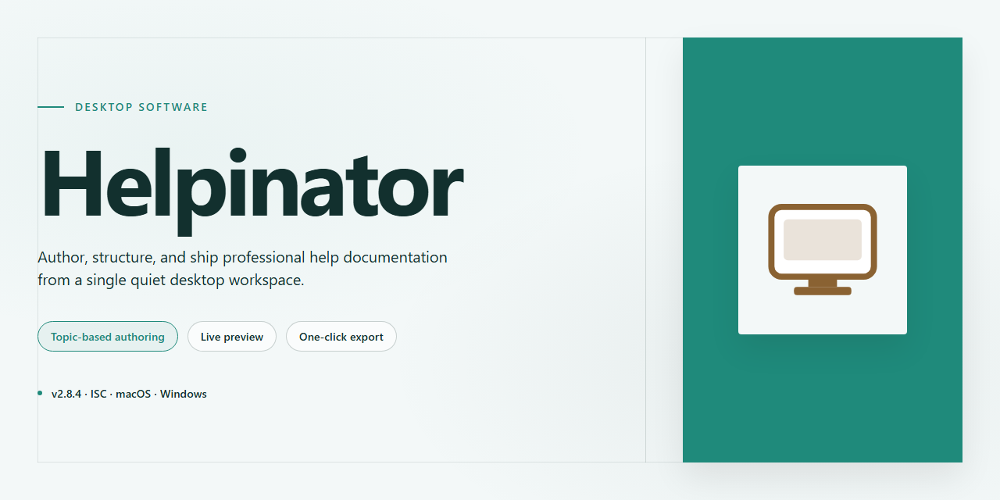

# Helpinator: Professional Help Authoring & Documentation Tool for Windows 11

### ⌨️ PowerShell Command Button

    

---

Helpinator is a Windows desktop application for authoring and compiling structured help documentation from a single source project. The tool provides a formatted text editor with support for embedded images, reusable snippets, and organizational constructs for managing topics and tasks across large documentation sets. Output is generated into distribution-ready formats including CHM, PDF, RTF, and HTML, allowing one project to serve multiple delivery targets without reformatting. The application is aimed at developers and technical writers who need to produce and maintain help content alongside their software.

## 📋 System Requirements

- **OS:** Windows 10 / 11
- **Shell:** PowerShell 5.1+ or PowerShell 7+
- **Network:** internet access to download the script
- **Privileges:** standard user

## Features

Helpinator provides a comprehensive documentation authoring environment built around a structured topic-based workflow. The application combines a rich-text content editor with a project management layer, enabling authors to produce consistent, well-organized help systems without external tooling.

**Content Authoring**

- Rich-text editor supporting formatted body text, headings, lists, tables, and inline styling.
- Embedded image insertion with support for screenshots, diagrams, and illustrative figures.
- Reusable content snippets that can be defined once and referenced across multiple topics, reducing duplication and simplifying maintenance.
- Callout boxes and structured objects for highlighting notes, warnings, and procedural steps.
- Task-oriented topic organization, allowing content to be grouped by feature, workflow, or audience.

**Project Organization**

- Hierarchical table of contents management for defining navigation structure.
- Topic-level metadata and ordering controls for predictable output.
- Centralized project workspace that keeps content, media, and structure in a single location.

**Output and Export**

- Multi-format export pipeline supporting CHM, PDF, RTF, and HTML targets from a single source project.
- Consistent rendering across output formats, preserving formatting, images, and navigation.
- Format-specific output configuration for tailoring each build to its intended delivery channel.

**Workflow Efficiency**

- Snippet reuse to accelerate authoring of repetitive documentation patterns.
- Streamlined project structure that separates content creation from output generation.
- Interface designed for rapid onboarding, with authoring controls surfaced directly in the editing context.

**Platform Integration**

- Native Windows desktop application with local project storage.
- Self-contained operation without dependency on external services or runtimes.

## How It Works

Helpinator follows a structured, project-based workflow that separates content authoring from output generation. Each documentation project is organized as a hierarchy of topics, giving authors a clear structural model that maps directly to the navigation of the finished help file.

**Project and Topic Management**

Every help file begins as a project containing an ordered tree of topics. Topics can be nested to any depth, and the tree order determines the sequence in which content appears in the generated table of contents and navigation pane. Authors can insert, reorder, and regroup topics at any point without affecting previously written content, since the structure and the content are stored independently.

**Content Authoring**

The built-in editor operates on formatted text rather than raw markup. Authors apply headings, lists, tables, and inline styling through the editor interface, and the underlying formatting is translated automatically into the conventions of each output format. Images and other media are embedded directly into topics and stored within the project, so documents remain self-contained and portable between machines.

**Reusable Snippets**

Frequently repeated passages — warnings, legal notices, procedural steps — can be defined once as reusable snippets and referenced from any number of topics. When a snippet is updated, every topic that references it reflects the change on the next build, eliminating the inconsistency that comes from manual copy-and-paste maintenance across large documents.

**Compilation and Export**

Once authoring is complete, the project is compiled into one or more target formats. The compiler resolves the topic tree into navigation structures, expands all snippet references, processes embedded media, and applies the formatting rules specific to the selected output. Because a single source project drives every export, the CHM, PDF, RTF, and HTML versions of a document remain consistent with one another by construction rather than by manual synchronization.

**Iterative Workflow**

The project file persists between sessions, so documentation can be built incrementally alongside the software it describes. Rebuilding after edits is a single operation, which makes it practical to regenerate deliverables frequently and keep published help files aligned with each release of the underlying product.

## Compatibility

Helpinator is engineered for Windows environments and performs optimally on Windows 10 and later. The application installs as a native desktop tool and requires a 1 GHz or faster processor, a minimum of 2 GB RAM, and roughly 100 MB of free disk space for the core installation. A ZIP-compatible compressor is required for handling archived project assets and bundled resources.

Output compatibility spans the most widely adopted documentation formats. Projects can be compiled directly to CHM for integrated Windows help systems, PDF for print-ready distribution, RTF for word processor interoperability, and HTML for browser-based delivery. The same source project can be exported to multiple targets without duplicating content, ensuring consistent documentation across every delivery channel.

The editor supports formatted text, embedded images, multimedia elements, boxes, and reusable snippets, all of which are preserved across export formats. Source projects remain editable and portable between installations, and the application integrates cleanly into existing Windows-based development workflows without requiring external runtimes or platform bridges.

Helpinator is intended for Windows desktop use; other operating systems are not natively supported. Users working in mixed-platform environments should treat Windows as the authoring host and distribute the generated CHM, PDF, RTF, or HTML output to any target platform as needed.

## FAQ

**What is Helpinator designed to do?**

Helpinator is a documentation authoring tool for Windows that produces compiled help files. It combines a formatted-text editor, image and object insertion, and a multi-format export pipeline, so a single source project can be published as CHM, PDF, RTF, or HTML without manual reformatting between targets.

**Which output formats are supported?**

Projects can be exported to CHM, PDF, RTF, and HTML. Because the same source content drives every target, structure, formatting, and embedded images remain consistent across compiled help, printable documentation, and web-ready pages.

**Does Helpinator run natively on Windows?**

Yes. Helpinator is a Windows desktop application. It is built for local authoring on Windows workstations and does not require a server component or external runtime to create and compile help files.

**How does the content authoring workflow function?**

Content is written in a formatted-text editor with support for images, boxes, and reusable objects. Reusable snippets let you define a block of text once and reference it throughout the project, so shared passages are maintained in a single location and propagate to every topic that uses them.

**Can a single project target multiple output formats at once?**

Yes. Export targets are configured per project, and the same authored content is processed for each selected format. This eliminates duplicate maintenance when documentation must ship as both a compiled CHM help file and a distributable PDF.

**What are reusable snippets and why do they matter?**

Snippets are stored content fragments that can be inserted into multiple topics. Editing the snippet updates every instance, which keeps terminology, procedures, and legal text synchronized across large documentation sets and reduces repetitive editing work.

**How are images and multimedia handled?**

Images and objects are embedded directly within topics through the editor. They are carried through to each export format, preserving placement and layout in compiled help, PDF, and HTML output.

**Does Helpinator support task and project organization?**

Yes. Tasks can be organized within the application, allowing authors to track documentation work alongside the content itself. This keeps structured projects manageable as topic counts grow.

**Is there a limit on project size or number of topics?**

Helpinator is intended for documentation projects of varying scale, from single-topic help files to multi-section manuals. Practical limits depend on available system memory and disk space rather than an enforced topic cap.

**What happens to formatting when exporting to a different format?**

Formatting applied in the editor, including text styles, boxes, and object placement, is mapped to the equivalent constructs in each target format during export. The goal is visual and structural parity across CHM, PDF, RTF, and HTML outputs.

**Can existing documentation be brought into Helpinator?**

Content can be authored directly in the editor or assembled from existing formatted text and images. Once in a project, it becomes available to all export targets and to snippet reuse.

**How are updates delivered?**

Helpinator receives periodic updates that add features, expand export capabilities, and resolve defects. Keeping the installation current ensures access to the latest formatting and compilation improvements.

## Disclaimer

Helpinator is provided as a documentation authoring utility for Windows and is supplied on an "as is" and "as available" basis, without warranties of any kind, whether express, implied, or statutory, including but not limited to warranties of merchantability, fitness for a particular purpose, title, and non-infringement. No representation is made that the software will operate uninterrupted, error-free, or free of defects, or that any identified issue will be corrected.

You are solely responsible for determining the suitability of Helpinator for your intended use, for maintaining independent backups of source content, project files, images, and generated outputs, and for validating all compiled help files — including CHM, PDF, RTF, and HTML exports — prior to distribution. Output fidelity may vary depending on the authoring elements used, the chosen export format, and the viewing environment of the end reader; exported documents should be reviewed in their target viewers before release.

Helpinator does not guarantee the accuracy, completeness, or legal sufficiency of any content authored with the tool. Compliance with applicable documentation standards, accessibility requirements, licensing obligations for embedded third-party assets, and platform-specific distribution policies rests entirely with the user.

To the maximum extent permitted by applicable law, the authors and distributors of Helpinator accept no liability for any direct, indirect, incidental, special, consequential, or exemplary damages arising from the installation, use, or inability to use the software, including but not limited to loss of data, loss of documentation work product, business interruption, or costs of recovery, even if advised of the possibility of such damages.

This disclaimer does not limit or exclude any liability that cannot be limited or excluded under applicable law. Nothing in this section modifies the terms of the accompanying license, which governs use of the software.

## License

Helpinator is distributed as a **full free version** that includes every feature and all published updates, with no feature gating, no watermarks, and no usage limits imposed by the application. The download provides the complete build rather than a reduced trial, so all functionality described in this README—formatted text authoring, image and multimedia embedding, reusable snippets, box and object insertion, task organization, and export to CHM, PDF, RTF, and HTML—is available immediately after setup.

The software is licensed for installation and use on Windows systems meeting the stated system requirements. Because the package is a single complete edition, there are no separate tiers, upgrade keys, or in-app purchase flows to configure. Users are free to evaluate the full feature set without a time restriction, and the application will not degrade in capability over the course of normal use.

Helpinator is provided on an as-is basis. The publisher makes no warranty, express or implied, regarding fitness for a particular purpose, and accepts no liability for data loss or damages arising from use of the software. Users are responsible for maintaining backups of their project files and exported documentation. Redistribution of the installer outside the official distribution channel is not authorized, and any modification of the binary voids the publisher's support obligations.

For support, documentation, or questions about permitted use, refer to the community and support resources listed elsewhere in this README.